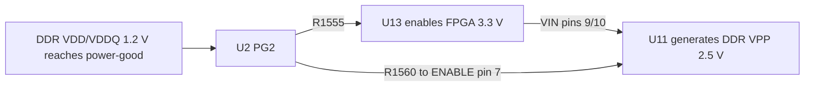

# DDR4 schematic follow-up: VRP, M4 lane isolation and power sequencing

4 November 2026. Offline review of
`C:/SVNProjects/IMU_Stabilize_v40/Circuit Diagram/tbt_camerasystem_251106.pdf`.
The directory contains this PDF and three extracted DDR page images; no PCB
layout, connectivity netlist, assembly BOM or measured power waveforms were
provided. PDF page numbers below are one-based; printed sheet numbers differ.

This extends the [DCI/XDC and historical-log review](DDR4_DCI_VRP_REVIEW_20261104.md).
It does not change the RTL, MIG, XDC or board. A schematic connection is not
proof of the assembled board's population or rework state.

## Findings and confidence

| Finding | Evidence | What it establishes |
|---|---|---|
| VRP66/AU27, VRP67/AR29 and VRP68/AP30 have no reference connections | PDF p.11; DCI enabled and no cascade in both routed checkpoints | A definite discrepancy between the drawn board and the configured DCI requirements |
| The previously isolated x16 contribution maps to DRAM M4 | PDF pp.11,18; current XDC; native-interface data ordering | Identifies the chip and signals to inspect, not proof that M4 silicon is defective |
| VPP is enabled downstream of DDR 1.2 V power-good | PDF pp.3,6,7; regulator pin functions | A schematic-implied power-up sequence inconsistent with the DRAM requirement under the shown population and normal PG operation |
| ALERT_n has 39.2 ohms to VTT and 1 kilohm to VDD | PDF pp.11,18; UG583 | A termination discrepancy; the current MIG does not use ALERT_n, so its effect on this failure is unproven |
| The image-carrying M3 and suspect M4 share FPGA bank 68 | Routed checkpoint and schematic pin map | Missing VRP68 is a shared concern, not a fault unique to M4 |
| Current memory part and nominal voltage configuration match the drawing | XCI and PDF pp.17-18 | No part/density mismatch identified; no claim about fitted markings or actual voltages |

The records still do not establish a single electrical cause of the old
corruption. Calibration success and a clean image using the bypass are
insufficient to establish full-interface reliability.

## Where the omitted and failing lanes physically go

The board draws five Micron `MT40A512M16TB-062E_R` x16, 8-Gbit devices.
The current XCI selects `MT40A512M16TB-062E`, 1.2 V, x48, BL8, a 4:1 PHY
clock ratio and a 1071 ps memory clock period (DDR4-1866 class).

All 95 current XDC assignments were cross-checked against the schematic:
48 DQ, 6 DM, 12 DQS wires, 27 address/control/CK/reset signals and 2 input
reference-clock wires. No byte assignment or DQS/CK polarity mismatch was
found. The same 93 DDR-port assignments match both archived routed designs.
This is a schematic-to-constraint comparison, not a PCB continuity test.

| Device | Board DQ labels | Board DQS/DM lanes | Current x48 DQ | Application data | Image use |
|---|---|---|---|---|---|
| M1 | 0-15 | 0,1 | Not bound | Not represented | Omitted by x48 remap |
| M2 | 16-31 | 2,3 | `[15:0]` | `[127:0]` | Used |
| M3 | 32-47 | 4,5 | `[31:16]` | `[255:128]` | Used |
| M4 | 48-63 | 6,7 | `[47:32]` | `[383:256]` | Bypassed in image payload |
| M5 | 64-79 | 8,9 | Not bound | Not represented | Already omitted from x64 |

M1/M2 are on PDF p.17; M3/M4/M5 are on p.18. All five share the command,
address, clock and chip-select nets. Omitting their data pins from MIG does
not physically remove the other devices or their command/address loading.

This mapping depends on the native interface's byte-oriented packing:
each DQ byte contributes a contiguous 64-bit group containing its eight
BL8 transfers. It is not one contiguous application chunk per time instant.
Consequently logical DQ bytes 4 and 5 occupy application bits `[383:256]`.
The same ordering applies to reads. See [AMD PG150, Write Path, DRAM DQ Bus
Data Map](https://docs.amd.com/r/en-US/pg150-ultrascale-memory-ip/Write-Path?contentId=~p_ZvVIFyCS30_GLdJ~KsA).

The exact generated DDR4 controller independently confirms this:
`ip/ddr4_sub64/rtl/controller/ddr4_v2_2_mc_ecc.sv:146-150` describes
byte-oriented native ordering; line 219 selects
`wr_data_ni2mc[burst*8 + pl_byte*64 +: 8]`, and lines 233-236 reconstruct
that order for the PHY. Lines 257-261 select the ECC-off path used here.
Thus the chip identification is not inferred only from stripe periodicity.

M4's two byte groups are therefore the targeted inspection area:

| Signal | FPGA pins | M4 pins |
|---|---|---|
| Lower DQS, board DQS6 / current DQS4 | AK31 / AL31 | G3 / F3, LDQS T/C |
| Upper DQS, board DQS7 / current DQS5 | AN30 / AN31 | B7 / A7, UDQS T/C |
| Lower DM, board DM6 / current DM4 | AH30 | E7 |
| Upper DM, board DM7 / current DM5 | AM28 | E2 |
| ZQ reference | DRAM-side only | F9 through R142, 240 ohms, to ground |
| VREFCA | `FU_MEM_A_VREF_4` | M1; divider R143/R144, 100 ohms each |
| VPP | `VDDR4_2V5` | B1 and R9 |

Here `M1` in the VREFCA row is a ball name on **component M4**, not component
M1. C333 connects VREFCA to ground; C332 bypasses the 1.2 V supply to ground.

M3 and M4 both use bank 68, while M2 uses bank 66 and address/control uses
bank 67. A bank-wide reference problem can coexist with differing lane
margins, but it does not by itself identify why M4 was worse than M3.
Compare M4 against M3 for actual reference values, rail noise, DQS/DQ
continuity, solder quality and routing before attributing the fault to a chip.

## Additional concern: VPP power-up ordering

The actual wiring is more informative than the repeated "SEQ 3" labels:

1. PDF p.3 identifies U2 ISL68224 rail 2 / PWM5 as DDR 1.2 V. Its sense
   connections return from `FU_DDR_VCCO_1V2`.
2. U2 PG2, pin 15, is `ISL68224_PG2_VCCDDR`, with R24 pulling it up to
   `+3V3S`. R1555 = 0 ohms routes it to `3P3V_ENABLE`; R1560 = 0 ohms
   routes it to `ISL80103IRZ_ENABLE`. Neither link is marked DNP.
3. PDF p.7: U13 ISL85014 uses `3P3V_ENABLE` at EN pin 14 to generate
   `FU_+3V3_VCCO`.
4. PDF p.6: U11 ISL80103 uses that 3.3 V rail at VIN pins 9/10 and
   `ISL80103IRZ_ENABLE` at ENABLE pin 7 to generate `VDDR4_2V5` for VPP.
   R55 is a power-good pull-up, not an independent enable path.

The Renesas [ISL68224 datasheet, section 6.1](https://www.renesas.com/en/document/dst/isl68224-datasheet)
defines PG as indicating completed soft-start and an output within its
regulation range. Under that behavior, the drawing makes VPP dependent on
VDD having already risen. No alternate U11 enable source was found in the PDF.

Micron requires VPP to rise before or with VDD and to remain at least as
high as VDD. See the manufacturer-authored [Micron 8-Gbit DDR4 datasheet,
Rev. R, pp.39-40 (mirror)](https://device.report/m/a82202ea0826ff816106a9e47d2ba37556d78fa4ed84981a0f9890a9b4a90970).
The drawn dependency therefore warrants a board-level power
sequence review. It is not a measurement of the rig, and the actual PMIC
configuration, fitted links and any rework remain unknown. This is a shared
supply issue; it does not establish why the historical error localized to M4.

Changing a firmware reset delay after power-up would not correct an earlier
rail-order violation. The hardware review should establish a compliant VPP
sequence while retaining the FPGA's own power requirements; this report does
not prescribe an unverified jumper or regulator modification.

## Networks that must not be confused with VRP

- The FPGA VREF pins on PDF p.16 have 1-kilohm ground resistors: R1476
  for bank 66, R1533 for bank 67 and R1535 for bank 68. The implemented
  DDR receiver banks use internal VREF. These are not DCI references.
- All five memories draw their own 240-ohm ZQ-to-ground resistor:
  M1/R87, M2/R88, M3/R93, M4/R142 and M5/R94. These calibrate the DRAM
  side, not the FPGA I/O banks. Verify fitted precision from the BOM.
- Each DRAM VREFCA is drawn as half of the common 1.2 V supply through a
  local equal-value divider. M4's values match the other devices; no unique
  wrong divider value is visible.
- VDD and VDDQ share `FU_DDR_VCCO_1V2`; VPP uses `VDDR4_2V5`.
  Nominal labels do not establish voltage accuracy, ripple or sequencing.

The prior finding remains: non-cascaded FPGA DCI requires references at
AU27, AR29 and AP30. Existing VREF, ZQ and command termination components
do not fill that role. [AMD PG150 DDR4 Pin Rules](https://docs.amd.com/r/en-US/pg150-ultrascale-memory-ip/DDR4-Pin-Rules),
[UG571](https://docs.amd.com/api/khub/documents/kFbaUC5HGcXyGNauhgU6Gw/content).

## ALERT_n and the two different clock networks

On PDF p.18, R122 = 39.2 ohms connects `FU_DDR4_ALERT_N` to `VDDR4_VTT`.
On p.11, R617 = 1 kilohm pulls the same net toward DDR 1.2 V. Neither is
marked DNP. AMD's [UG583 alert_n guidance](https://docs.amd.com/r/en-US/ug583-ultrascale-pcb-design/alert_n)
calls for termination to VDD through 50 ohms, including when the PL
controller does not expose ALERT_n.

With ideal 1.2 V/0.6 V rails and no other load, the two drawn resistors
would bias ALERT_n to approximately
`(1.2/1000 + 0.6/39.2)/(1/1000 + 1/39.2) = 0.623 V`.
That is a calculation from the drawing, not a measured voltage.
The current configuration has command/address parity disabled and no MIG
ALERT_n port, so this discrepancy is not evidence that it caused the
observed image corruption. It should still be reconciled in the board review.

The separate clock circuits must not be conflated:

- **MIG reference input, p.11:** Y2 `590BD200M000DG` is a 200 MHz, 3.3 V
  LVDS oscillator according to the [Si590 ordering table](https://www.skyworksinc.com/-/media/SkyWorks/SL/documents/public/data-sheets/Si590-591.pdf).
  OUT+ pin 4 passes through C523 to AR32/P; OUT- pin 5 passes through C522
  to AT32/N. Both capacitors are 0.1 uF. R634/R635 and R637/R638 provide
  nominal 0.6 V bias; R636 supplies 100-ohm differential termination.
  The generated non-DCI `DIFF_SSTL12` and disabled internal differential
  termination do not imply an absent external clock termination.
- **DDR CK output, p.18:** R127/R128 are 36 ohms each to a common midpoint,
  giving 72 ohms differential. C282 = 0.01 uF AC-references the midpoint
  to the 1.2 V rail. This is not the R636 input-clock network and is not a
  direct DC short of CK to VDD. Suitability for the actual trace impedance
  and five-device fly-by route requires the PCB and signal-integrity evidence.

No clock jitter, eye opening, rail ripple or termination placement was
measured in this review. Correct logical connectivity does not certify those
electrical properties.

## A separate post-calibration failure mechanism to test

AMD [Answer Record 70006](https://adaptivesupport.amd.com/s/article/70006?language=en_US)
documents a specific all-zero, repeated isolated-BL8-read pattern that can
produce VCCO noise and data errors after calibration. The present design has
32 DQ in bank 68 and `DM_NO_DBI`, so it is worth a controlled pattern test;
those settings alone do not prove that the problematic access pattern occurred.

The older `docs/DDR_EO_PANORAMA_FIX_PLAN.md` in the panorama-base repository
mentions AR70006, but the reviewed records do not contain a controlled DBI,
VCCO-noise or all-zero-pattern experiment. The keepalive/rate changes do not
establish or eliminate this mechanism. Correct the confirmed reference
configuration and check power sequencing before treating DBI as a remedy.

The old eye-scan start and coarse-tap-write attempts were rejected as writes
to read-only properties (`codex_ddr_eyescan.log:72` and
`codex_takeover_mig_writable.log:79` in the panorama-base repository).
They are not completed electrical margin experiments. The inspected design
also has no exposed DCI-lock observation. A simulated lock indication cannot
substitute for a physical VRP/impedance check.

## Measurements that can distinguish the causes

| Order | Check | Evidence to record |
|---|---|---|
| 1 | Establish the assembled board revision, fitted parts, PMIC configuration and rework | BOM/netlist/layout identity; powered-off VRP-to-ground resistance at all three banks |
| 2 | Scope VDD/VDDQ and VPP during cold power-up, power-down and restart | Simultaneous traces at DRAM decouplers; PG2, U11 enable and RESET_n timing; verify VPP never falls below VDD where required |
| 3 | Inspect the M4 interface against M3 | R142/ZQ, R143/R144/VREFCA, local rail behavior, DQS/DM/DQ connections, BGA joints and PCB lengths/vias/return paths |
| 4 | Restore documented DCI references using a reviewed board correction | Same bitstream/rate before and after; calibration logs and per-byte margins |
| 5 | Run a full-width x48 diagnostic without the image bypass | An active read-versus-written-data checker; errors by DQ byte, bit, address and burst; zero/one, walking-bit, alternating and PRBS patterns; continuous versus isolated reads |
| 6 | Evaluate pattern sensitivity and then restore x64 | Controlled DBI/encoding experiment if warranted; repeat cold starts and temperature/voltage corners; do not use clean low-256 image output as a full-width pass |

PCB topology and signal integrity cannot be certified from the schematic
alone. No new live calibration, resistance, waveform or memory-error
measurement was made during this disconnected investigation.

## Evidence package

The [schematic follow-up evidence](validation/ddr4_schematic_followup_20261104/)
contains the 95-port pin-trace CSV, the M4 trace, all five DRAM data-pin
tables, a structured audit, extracted schematic net coordinates, source
excerpts and selected unaltered schematic crops. The extraction and comparison
scripts are included with their original local paths; they can be adapted
if the source files move. Extraction requires Python and PyMuPDF (`fitz`);
the comparison script uses the Python standard library and the previous
checkpoint query summary. The crops retain original drawing content and are
for navigation, not a substitute for the complete PDF.

`source_manifest.json` identifies the original files and manufacturer
references. `package_manifest.json` records the archived files' SHA-256
hashes. The original schematic hash remains
`65c5ed684024664e2938056389423a948b5d8b935180e16c382f76699369d0ee`.

Useful image excerpts:

- [PG2 enable branches, PDF p.3](validation/ddr4_schematic_followup_20261104/pg2_enable_branches.png)
- [VPP regulator, PDF p.6](validation/ddr4_schematic_followup_20261104/vpp_regulator.png)
- [M4 device and its local references, PDF p.18](validation/ddr4_schematic_followup_20261104/dram_m4.png)
- [Reference input clock, PDF p.11](validation/ddr4_schematic_followup_20261104/reference_clock.png)
